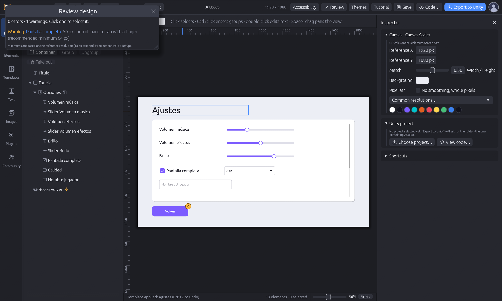
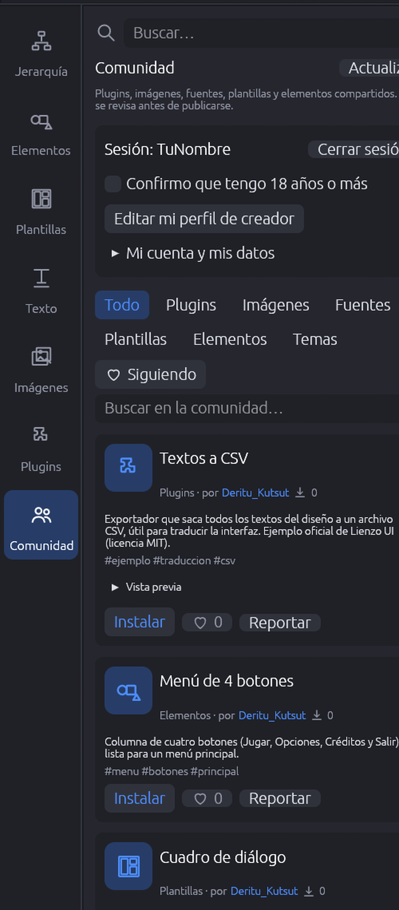
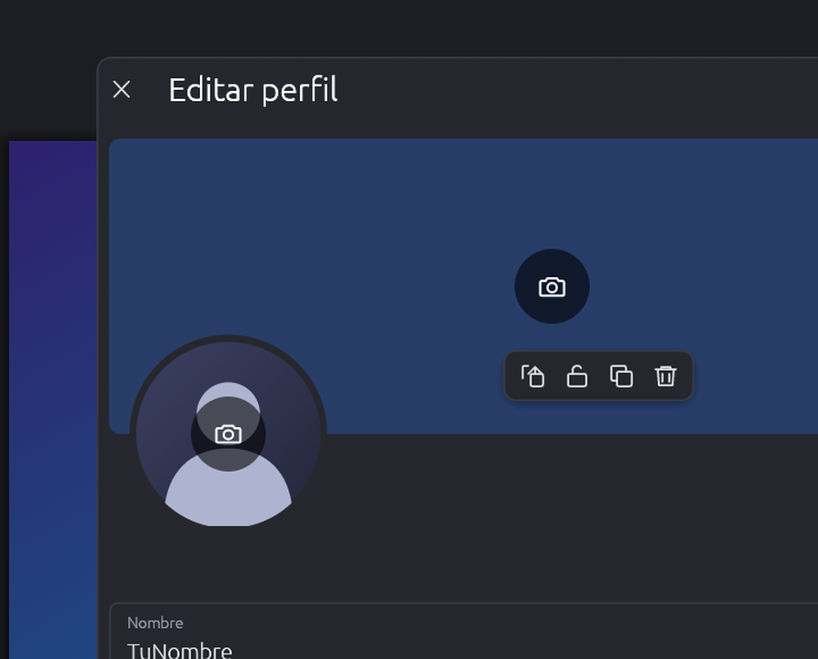
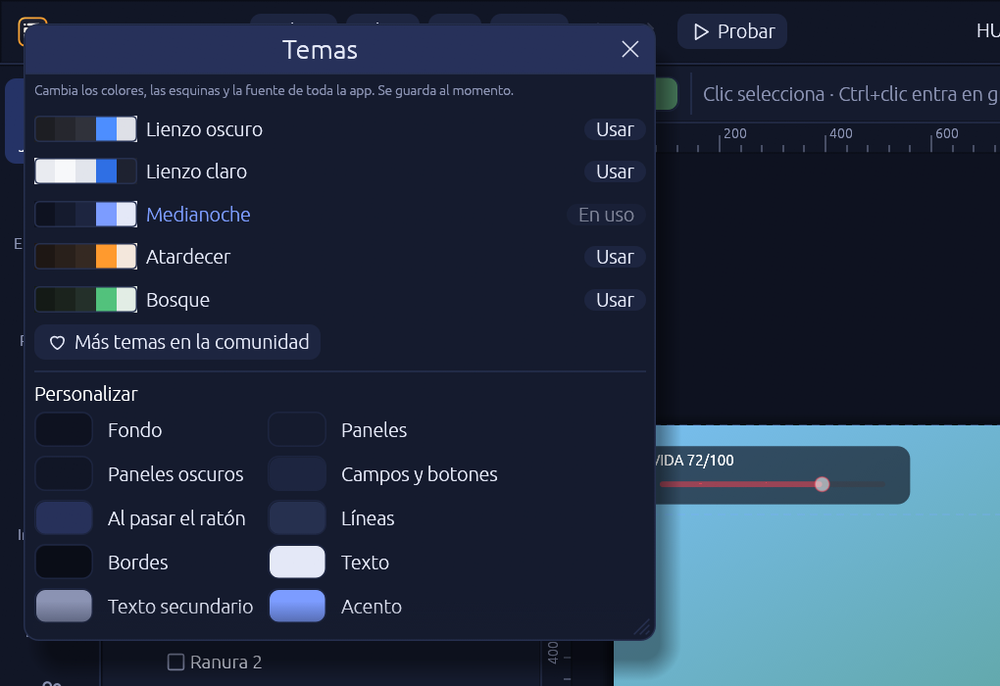

<p align="center"></p>

# Lienzo UI

**A visual editor for game interfaces that exports to Unity.** Lay out menus, HUDs, dialogs, settings and inventories like in a design tool (canvas, handles, smart guides, layers), test them on any screen size, and export them to Unity as **uGUI + TextMeshPro prefabs**, **UI Toolkit (UXML + USS)** and **IMGUI** in one click. Free and open source (MIT).

[Download for Windows](../../releases/latest) · [itch.io](https://deritu.itch.io/lienzo-ui) · [Español ↓](#español)

🎬 [Trailer in English](https://youtu.be/7G-g5H3nHtg) · [Tráiler en español](https://youtu.be/xb7x16KGKBY)

<p align="center">
 <br>

</p>

## Features

- **Design-tool editing:** drag elements onto the canvas, resize and rotate with handles, smart guides, multi-selection, groups, layers, undo/redo, copy/paste.
- **Real Unity concepts:** RectTransform anchors and pivots, Canvas Scaler (reference resolution and match), Horizontal/Vertical/Grid layout groups, ScrollView, masks.
- **11 element types:** panel, ellipse, image, text, button, toggle, slider, input field, dropdown, scroll view and empty.
- **13 templates:** main menu, game HUD, dialog window, settings, inventory, pause menu, game over, level select, loading screen, character dialogue, leaderboard, character select, or start blank. Save your own templates and elements.
- **Ready-made components and HUD text:** pill/outline/close buttons, health and mana bars, cards, badges, slots, timer, coins, damage numbers, combo and subtitles.
- **Review design:** one click checks text size, contrast (WCAG), touch-target size, off-page elements, duplicate names and missing images before you export.
- **Test mode (F5):** click through your UI, run small click scripts (Rhai) and preview other screens (phones, 4:3, ultrawide).
- **One-click export to Unity:** a uGUI prefab rebuilt automatically when the design changes, plus UXML/USS, an IMGUI script and typed *View* scripts for your game logic (your code is never overwritten).
- **Pixel art mode:** nearest-neighbor images and whole-pixel positions in the editor; Canvas *Pixel Perfect* and Point-filtered, uncompressed sprites in Unity.
- **Plugins:** add commands, exporters and templates with sandboxed Rhai scripts, no recompiling ([guide](docs/PLUGINS.md)).
- **Accessibility:** Spanish or English interface, UI scale up to 200 %, high contrast and reduced motion.
- **In-app tutorial** for beginners and professionals: it opens on first launch, then the editor opens; reopen it with the **Tutorial** button or F1.
- **Community:** browse, install and share plugins, images, fonts, templates, elements and themes, with creator profiles, follow and hearts, moderation and 18+ filter ([how it works](#community)).
- **Themes:** change the colours, corners and font of the whole app.
- **Command line** for automation: `--plantillas`, `--plantilla N`, `--abrir`, `--guardar`, `--exportar`, `--revisar`, `--screenshot`, `--probar`.
- **MCP server for any AI** (`mcp/`): Claude, Cursor, VS Code or any MCP client can create and edit designs, export them to Unity and take screenshots.

## New in 1.3

<p align="center"> </p>

- **7 new templates** (Pause menu, Game over, Level select, Loading screen, Character dialogue, Leaderboard, Character select). Open the **Templates** tab and click one; Ctrl+Z undoes it. They scale to fit any reference resolution, including portrait.
- **Review design:** click **Review** in the header. Each warning names the element; click it to select it and fix it. From the command line: `lienzo-ui --abrir my.editorgui.json --revisar` (exit code 1 if there are errors, handy in CI). From an AI: MCP tool `revisar_diseno`.
- **Elements › Ready-made components** and **Text › For buttons and HUD:** click to add at the centre, or drag onto a panel to make it a child.
- **Images:** 8 more gradient placeholders (exported to uGUI as generated sprites).

Full list in the [changelog](CHANGELOG.md).

## Quick start

1. Download `LienzoUI-windows.zip` from the [releases](../../releases/latest), unzip and run `lienzo-ui.exe`.
2. Follow the tutorial, pick a template and edit it.
3. Click **Export to Unity** (Ctrl+E) and choose your Unity project folder (the one that contains `Assets`).
4. Back in Unity, the prefab appears in `Assets/EditorGUI/Prefabs`. Menu: **Tools › Lienzo UI**.

Unity requirements: the *Unity UI* package (uGUI with TextMeshPro). Tested on Unity 6 (6000.3) with URP.

## Build from source

```bash
cargo build --release      # Rust 1.85+ (edition 2024)
cargo test
./target/release/lienzo-ui
```

## Community

Share and find **plugins, images, fonts, templates, elements and themes** without leaving the app. Browsing needs no account.

<p align="center"> </p>

### Browse and install

1. Open the **Community** tab (left rail). Pick a category (Plugins, Images, Fonts, Templates, Elements, Themes) or search.
2. Click **Install**. The file is downloaded, its SHA-256 fingerprint is checked and it is validated again before it touches your disk. Plugins appear in the *Plugins* tab, images in *Images*, fonts in *Text*, templates under *Templates › My templates*, elements in *Elements* and themes are applied at once.
3. Click the heart to give a **heart** (like a GitHub star), the author's name to open their **creator profile**, and **Follow** to see their work under **♥ Following**.
4. Something wrong? **Report** it.

### Create your account and creator profile

1. In **Community**, press **Sign in with GitHub** or **Sign in with Google**. Your browser opens; approve and come back (there are no passwords: Lienzo UI only keeps a public name).
2. Choose your **public name** (3-32 characters), accept the rules and press **Create profile**.
3. Press the **round photo button** at the top right, or **Edit my creator profile**, to open the profile editor:

<p align="center"></p>

4. Use the camera buttons to set your **profile picture** and **banner** (any PNG, JPEG, WebP, GIF or BMP: the app crops and resizes it), then fill in your **bio**, **GitHub** and social links (X, YouTube, itch.io, Twitch, Bluesky, Instagram) and press **Save**.

Your profile is public once you have at least one approved item. Pictures and text are moderated: you see your new picture at once, others see it when a person approves it. Your email is never shown.

### Share your own content

1. Sign in, then open **Share with the community** in the Community tab.
2. Choose the type, write a title and description, add tags and pick the file (for a plugin, pick its folder; for a template, press **Use the open design**; for a theme, press **Use the current theme**). Add an optional **preview** image (PNG up to 1920×1080). Mark it **18+** if it is.
3. Press **Send for review**. It is checked automatically (file format, antivirus, text moderation) and either published, sent to a person for review, or rejected with the reason.

Only data formats are accepted (PNG, JPEG, GIF, WebP, TTF, OTF, JSON): never executables, installers, scripts or archives. 18+ content is hidden unless your account confirms it is 18 or older. Details: [Community guide](docs/COMUNIDAD.md).

### Themes

The **Themes** button changes the colours, corners and font of the whole app, saves your own themes and shares them in the community.

<p align="center"></p>

### Moderators

Moderation lives in a web panel (also usable by AIs with revocable tokens): [docs/MODERACION.md](docs/MODERACION.md).

## Documentation

| Guide | For |
|---|---|
| [Beginner tutorial](docs/TUTORIAL_BEGINNERS.md) ([español](docs/TUTORIAL_NOVATOS.md)) | First design and first export |
| [Pro tutorial](docs/TUTORIAL_PROS.md) ([español](docs/TUTORIAL_PROFESIONALES.md)) | Export format, anchors, layouts, scripting, Review design, command line |
| [Extending Lienzo UI](docs/EXTENDER.md) | Adding elements, templates, exporters, tutorial pages |
| [Plugins](docs/PLUGINS.md) | Writing commands, exporters and templates |
| [MCP server](docs/MCP.md) | Connect any AI (your own key or a local model) to Lienzo UI, or script it with an AI API |
| [Contributing](CONTRIBUTING.md) · [Changelog](CHANGELOG.md) | Pull requests and releases |

## License

[MIT](LICENSE). Independent project, not affiliated with Unity Technologies or Canva. Built with the help of AI (Claude); cover art generated with ChatGPT.

---

## Español

**Lienzo UI es un editor visual de interfaces de juego que exporta a Unity.** Diseña menús, HUD, ventanas, ajustes e inventarios como en una herramienta de diseño, pruébalos en cualquier pantalla y expórtalos a Unity como prefab uGUI + TextMeshPro, UI Toolkit (UXML + USS) e IMGUI con un clic. Gratis y de código abierto (MIT).

🎬 [Tráiler en español](https://youtu.be/xb7x16KGKBY) · [Trailer in English](https://youtu.be/7G-g5H3nHtg)

- **Probarlo:** descarga `LienzoUI-windows.zip` de las [releases](../../releases/latest) y abre `lienzo-ui.exe`. La primera vez se abre el tutorial; al terminarlo se abre el editor (botón **Tutorial** o F1 para volver).
- **Novedades de la 1.3:** 7 plantillas nuevas (pausa, fin de partida, selección de nivel, carga, diálogo de personaje, clasificación y selección de personaje), **componentes listos** en Elementos, **estilos de HUD** en Texto y 8 degradados más. El botón **Revisar** de la cabecera avisa de letra pequeña, poco contraste, botones pequeños para tocar, elementos fuera de la página, nombres repetidos e imágenes que faltan; clic en un aviso para seleccionar el elemento. También con `--revisar` (sale con código 1 si hay errores) y con la herramienta MCP `revisar_diseno`.
- **Pixel art, plugins y accesibilidad:** modo pixel art, plugins con scripts Rhai ([guía](docs/PLUGINS.md)) e interfaz en español o inglés con tamaño hasta 200 %, alto contraste y movimiento reducido.
- **Aprender:** [tutorial para novatos](docs/TUTORIAL_NOVATOS.md), [tutorial para profesionales](docs/TUTORIAL_PROFESIONALES.md), [cómo añadir cosas](docs/EXTENDER.md) y [servidor MCP para IA](docs/MCP.md).
### Comunidad

Comparte y encuentra **plugins, imágenes, fuentes, plantillas, elementos y temas** sin salir de la app. Explorar no necesita cuenta.

- **Explorar e instalar:** pestaña **Comunidad** › elige categoría › **Instalar**. Se verifica la huella SHA-256 y se valida de nuevo antes de tocar tu disco. Corazones (como la estrella de GitHub), **Seguir** creadores y **Reportar**.
- **Crear tu cuenta y perfil de creador:** en Comunidad pulsa **Entrar con GitHub** o **Entrar con Google** (sin contraseñas), elige tu **nombre público** y pulsa **Crear perfil**. Luego pulsa el **botón redondo con tu foto** (arriba a la derecha) para editar tu perfil: foto, banner, biografía, GitHub y redes. Las fotos se recortan y reducen solas.
- **Subir contenido:** **Compartir con la comunidad** › tipo, título, descripción, etiquetas y archivo (plugin: su carpeta; plantilla: **Usar el diseño abierto**; tema: **Usar el tema actual**), vista previa opcional › **Enviar a revisión**. Se revisa automáticamente (formato, antivirus y moderación) y se publica, pasa a revisión humana o se rechaza con su motivo. Solo formatos de datos: nunca ejecutables ni scripts. Lo +18 está oculto salvo que tu cuenta confirme ser mayor de edad.
- **Temas:** botón **Temas** para cambiar colores, esquinas y fuente de la app, y guardarlos o compartirlos.
- **Moderación:** panel web (también para IAs con tokens revocables): [docs/MODERACION.md](docs/MODERACION.md). Guía completa: [docs/COMUNIDAD.md](docs/COMUNIDAD.md). Las capturas de arriba muestran cada paso.
- **Contribuir:** lee [CONTRIBUTING.md](CONTRIBUTING.md). Toda mejora es bienvenida.
