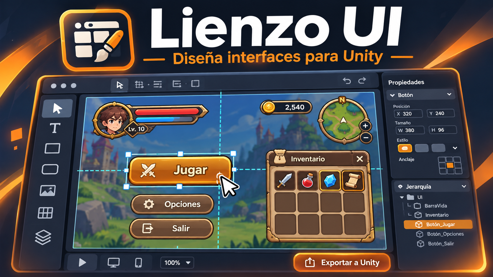
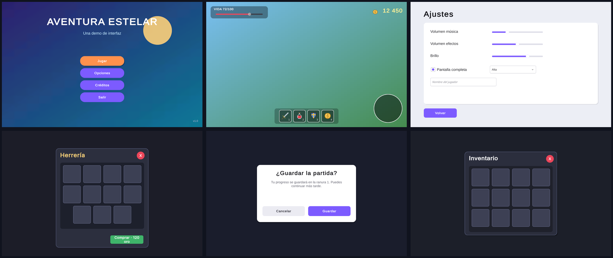
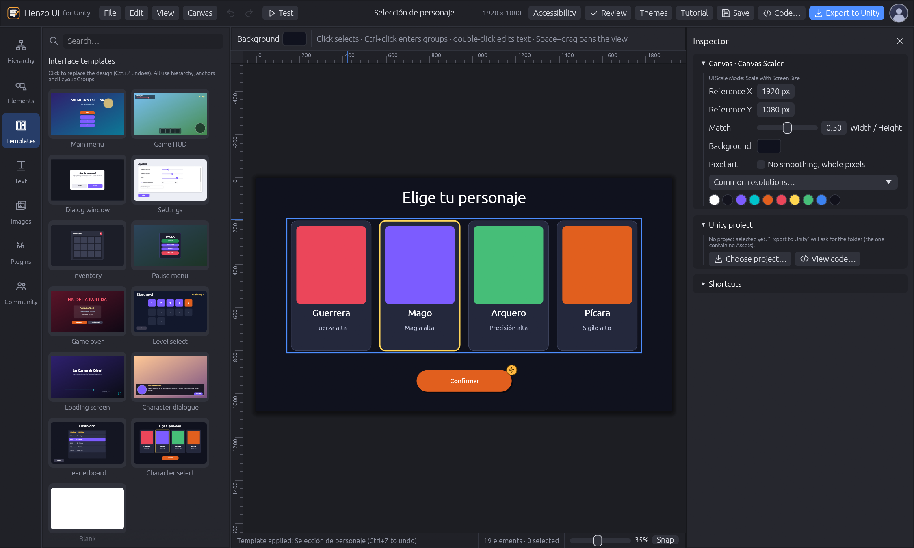
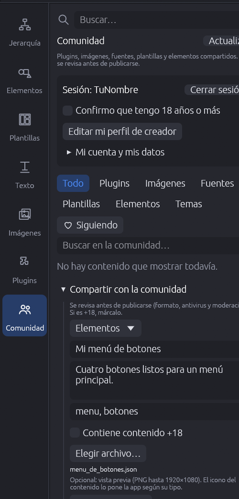

<p align="center"></p>

# Lienzo UI

**A visual editor for game interfaces that exports to Unity.** Lay out menus, HUDs, dialogs, settings and inventories like in a design tool (canvas, handles, smart guides, layers), test them on any screen size, and export them to Unity as **uGUI + TextMeshPro prefabs**, **UI Toolkit (UXML + USS)** and **IMGUI** in one click. Free and open source (MIT).

[Download for Windows](../../releases/latest) · [itch.io](https://deritu.itch.io/lienzo-ui)

🎬 [Trailer in English](https://youtu.be/7G-g5H3nHtg) · [Trailer in Spanish](https://youtu.be/xb7x16KGKBY)

<p align="center">
 <br>

</p>

## Features

- **Design-tool editing:** drag elements onto the canvas, resize and rotate with handles, smart guides, multi-selection, groups, layers, undo/redo, copy/paste.
- **Real Unity concepts:** RectTransform anchors and pivots, Canvas Scaler (reference resolution and match), Horizontal/Vertical/Grid layout groups, ScrollView, masks.
- **11 element types:** panel, ellipse, image, text, button, toggle, slider, input field, dropdown, scroll view and empty.
- **15 templates:** main menu, game HUD, dialog window, settings, inventory, pause menu, game over, level select, loading screen, character dialogue, leaderboard, character select, a pixel RPG HUD, a pixel main menu, or start blank. Save your own templates and elements.
- **Ready-made components and HUD text:** pill/outline/close buttons, health and mana bars, cards, badges, slots, timer, coins, damage numbers, combo and subtitles.
- **Review design:** one click checks text size, contrast (WCAG), touch-target size, off-page elements, duplicate names and missing images before you export.
- **Test mode (F5):** click through your UI, run small click scripts (Rhai) and preview other screens (phones, 4:3, ultrawide).
- **Import from Unity:** turn existing uGUI prefabs into editable designs (names, anchors, layouts, sprites and 9-slice kept), see [docs/UNITY_IMPORT.md](docs/UNITY_IMPORT.md).
- **Portrait and landscape layouts** in the same design, with a runtime switch in Unity.
- **One-click export to Unity:** a uGUI prefab rebuilt automatically when the design changes, plus UXML/USS, an IMGUI script and typed *View* scripts for your game logic (your code is never overwritten).
- **Pixel art mode:** nearest-neighbor images and whole-pixel positions in the editor; Canvas *Pixel Perfect* and Point-filtered, uncompressed sprites in Unity.
- **Plugins:** add commands, exporters and templates with sandboxed Rhai scripts, no recompiling ([guide](docs/PLUGINS.md)).
- **Accessibility:** interface in English, Spanish, Portuguese, French, German, Italian, Russian, Chinese, Japanese or Korean, UI scale up to 200 %, high contrast and reduced motion.
- **In-app tutorial** for beginners and professionals: it opens on first launch, then the editor opens; reopen it with the **Tutorial** button or F1.
- **Community:** browse, install and share plugins, images, fonts, templates, elements and themes, with creator profiles, follow and hearts, moderation and 18+ filter. Preview a font or a plugin (and read its code) before installing, and translate any description with one click ([how it works](#community)).
- **Themes:** change the colours, corners and font of the whole app.
- **Command line** for automation: `--templates`, `--template N`, `--open`, `--save`, `--export`, `--review`, `--screenshot`, `--test`, `--page WxH`. The old Spanish flags (`--abrir`, `--exportar`…) still work.
- **MCP server for any AI** (`mcp/`): Claude, Cursor, VS Code or any MCP client can create and edit designs, export them to Unity and take screenshots.

## What's new

**1.7.3**
- **MCP safety notice:** the MCP server now tells every AI that `export_unity` writes straight into your Unity project and asks it to dry-run first, show you the list and wait for your confirmation (see [Safe exports](docs/MCP.md#safe-exports-read-this-before-connecting-an-ai)). Both tutorials (in the app and in `docs/`, 10 languages) cover everything new.
- **Export preview (`dry_run`):** the MCP tool `export_unity` takes `dry_run: true` (and the command line `--export <project> --dry-run`) to list every file that would be created, updated or removed in your Unity project, without writing anything.
- **Community: preview before you install.** Fonts show sample text drawn with the font; plugins show their commands, exporters, files and code (read-only). Nothing is installed.
- **Community: Translate button** on every description, and on what a plugin preview shows (free MyMemory service, only when you press it; the note "automatic translation" is always shown, and *Show original* goes back).
- **Portrait view of every template:** the Portrait button now shows a layout designed for phones (1080 × 1920): Level select with 4 buttons per row, Character select in 2 × 2, the pixel HUD and menu rearranged, nothing cut off or overlapping. Building a template on a portrait page also fits now.

**1.6**
- **Built-in content pack:** 108 images that ship inside the app (backgrounds, frames, nine-slice buttons, icons and 55 pixel-art pieces).
- **15 templates**, including a pixel-art RPG HUD and a pixel main menu.
- **Autosave and crash recovery**, review **quick fixes** («Fix all safe issues») and an undo budget so huge designs stay safe.
- **Community:** 14 new plugins and 18 free fonts, offline mode, and terms, licences and copyright reports for what you share.

**1.5 and earlier:** import existing uGUI prefabs from Unity, portrait and landscape layouts in one design, sprite 9-slice and pixels-per-unit, 10 interface languages, and an MCP server for any AI.

Full list in the [changelog](CHANGELOG.md).

## New in 1.3

<p align="center"> </p>

- **7 new templates** (Pause menu, Game over, Level select, Loading screen, Character dialogue, Leaderboard, Character select). Open the **Templates** tab and click one; Ctrl+Z undoes it. They scale to fit any reference resolution, including portrait.
- **Review design:** click **Review** in the header. Each warning names the element; click it to select it and fix it. From the command line: `lienzo-ui --open my.editorgui.json --review` (exit code 1 if there are errors, handy in CI). From an AI: MCP tool `review_design`.
- **Elements › Ready-made components** and **Text › For buttons and HUD:** click to add at the centre, or drag onto a panel to make it a child.
- **Images:** 8 more gradient placeholders (exported to uGUI as generated sprites).

**1.3.2:** the interface, the built-in tutorial and the written tutorials are available in 10 languages: English, Spanish, Portuguese, French, German, Italian, Russian, Chinese, Japanese and Korean (**Accessibility › Language**).

Full list in the [changelog](CHANGELOG.md).

## Quick start

1. Download `LienzoUI-windows.zip` from the [releases](../../releases/latest), unzip and run `lienzo-ui.exe`.
2. Follow the tutorial, pick a template and edit it.
3. Click **Export to Unity** (Ctrl+E) and choose your Unity project folder (the one that contains `Assets`).
4. Back in Unity, the prefab appears in `Assets/EditorGUI/Prefabs`. Menu: **Tools › Lienzo UI**.

Unity requirements: the *Unity UI* package (uGUI with TextMeshPro). Tested on Unity 6 (6000.3) with URP.

## Build from source

```bash
cargo build --release      # Rust 1.85+ (edition 2024)
cargo test
./target/release/lienzo-ui
```

## Community

Share and find **plugins, images, fonts, templates, elements and themes** without leaving the app. Browsing needs no account.

<p align="center"> </p>

### Browse and install

1. Open the **Community** tab (left rail). Pick a category (Plugins, Images, Fonts, Templates, Elements, Themes) or search.
2. Click **Install**. The file is downloaded, its SHA-256 fingerprint is checked and it is validated again before it touches your disk. Plugins appear in the *Plugins* tab, images in *Images*, fonts in *Text*, templates under *Templates › My templates*, elements in *Elements* and themes are applied at once.
3. Click the heart to give a **heart** (like a GitHub star), the author's name to open their **creator profile**, and **Follow** to see their work under **♥ Following**.
4. Something wrong? **Report** it.

### Create your account and creator profile

1. In **Community**, press **Sign in with GitHub** or **Sign in with Google**. Your browser opens; approve and come back (there are no passwords: Lienzo UI only keeps a public name).
2. Choose your **public name** (3-32 characters), accept the rules and press **Create profile**.
3. Press the **round photo button** at the top right, or **Edit my creator profile**, to open the profile editor:

<p align="center"></p>

4. Use the camera buttons to set your **profile picture** and **banner** (any PNG, JPEG, WebP, GIF or BMP: the app crops and resizes it), then fill in your **bio**, **GitHub** and social links (X, YouTube, itch.io, Twitch, Bluesky, Instagram) and press **Save**.

Your profile is public once you have at least one approved item. Pictures and text are moderated: you see your new picture at once, others see it when a person approves it. Your email is never shown.

### Share your own content

1. Sign in, then open **Share with the community** in the Community tab.
2. Choose the type, write a title and description, add tags and pick the file (for a plugin, pick its folder; for a template, press **Use the open design**; for a theme, press **Use the current theme**). Add an optional **preview** image (PNG up to 1920×1080). Mark it **18+** if it is.
3. Press **Send for review**. It is checked automatically (file format, antivirus, text moderation) and either published, sent to a person for review, or rejected with the reason.

Only data formats are accepted (PNG, JPEG, GIF, WebP, TTF, OTF, JSON): never executables, installers, scripts or archives. 18+ content is hidden unless your account confirms it is 18 or older. Details: [Community guide](docs/COMMUNITY.md).

### Themes

The **Themes** button changes the colours, corners and font of the whole app, saves your own themes and shares them in the community.

<p align="center"></p>

### Moderators

Moderation lives in a web panel (also usable by AIs with revocable tokens): [docs/MODERATION.md](docs/MODERATION.md).

## Documentation

| Guide | For |
|---|---|
| [Beginner tutorial](docs/TUTORIAL_BEGINNERS.md) ([es](docs/TUTORIAL_BEGINNERS.es.md) · [pt](docs/TUTORIAL_BEGINNERS.pt.md) · [fr](docs/TUTORIAL_BEGINNERS.fr.md) · [de](docs/TUTORIAL_BEGINNERS.de.md) · [it](docs/TUTORIAL_BEGINNERS.it.md) · [ru](docs/TUTORIAL_BEGINNERS.ru.md) · [zh](docs/TUTORIAL_BEGINNERS.zh.md) · [ja](docs/TUTORIAL_BEGINNERS.ja.md) · [ko](docs/TUTORIAL_BEGINNERS.ko.md)) | First design and first export |
| [Pro tutorial](docs/TUTORIAL_PROS.md) ([es](docs/TUTORIAL_PROS.es.md) · [pt](docs/TUTORIAL_PROS.pt.md) · [fr](docs/TUTORIAL_PROS.fr.md) · [de](docs/TUTORIAL_PROS.de.md) · [it](docs/TUTORIAL_PROS.it.md) · [ru](docs/TUTORIAL_PROS.ru.md) · [zh](docs/TUTORIAL_PROS.zh.md) · [ja](docs/TUTORIAL_PROS.ja.md) · [ko](docs/TUTORIAL_PROS.ko.md)) | Export format, anchors, layouts, scripting, Review design, command line |
| [File format](docs/FORMAT.md) · [Import from Unity](docs/UNITY_IMPORT.md) | The `.editorgui.json` schema, and converting uGUI prefabs |
| [Extending Lienzo UI](docs/EXTENDING.md) | Adding elements, templates, exporters, tutorial pages |
| [Plugins](docs/PLUGINS.md) | Writing commands, exporters and templates |
| [MCP server](docs/MCP.md) | Connect any AI (your own key or a local model) to Lienzo UI, or script it with an AI API |
| [Contributing](CONTRIBUTING.md) · [Changelog](CHANGELOG.md) | Pull requests and releases |

## Legal

The desktop app is MIT-licensed and works offline. The online Community is covered by its own rules:
[Terms of Use](docs/TERMS.md) · [Community Guidelines](docs/COMMUNITY_GUIDELINES.md) · [Privacy Policy](docs/PRIVACY.md) · [Copyright and Takedown Policy](docs/COPYRIGHT.md) · [Moderator playbook](docs/ENFORCEMENT.md)

## License

[MIT](LICENSE). Independent project, not affiliated with Unity Technologies or Canva. Built with the help of AI (Claude); cover art generated with ChatGPT.
