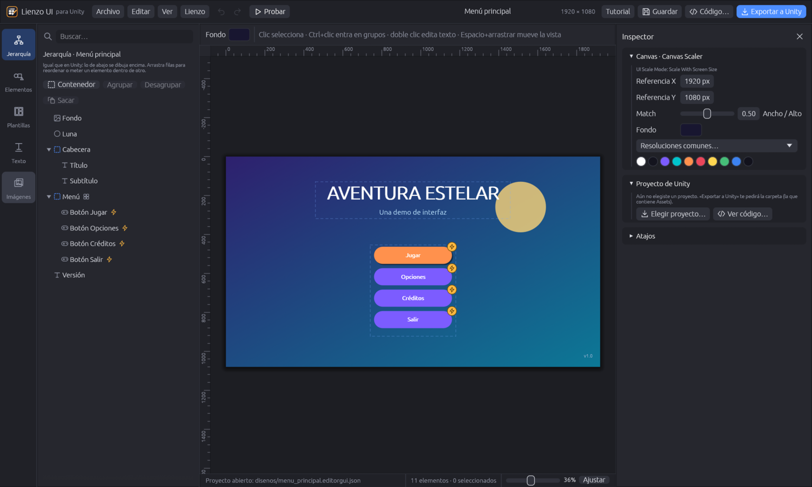

# Tutorial per principianti

🌐 [English](TUTORIAL_BEGINNERS.md) · [Español](TUTORIAL_BEGINNERS.es.md) · [Português](TUTORIAL_BEGINNERS.pt.md) · [Français](TUTORIAL_BEGINNERS.fr.md) · [Deutsch](TUTORIAL_BEGINNERS.de.md) · [Italiano](TUTORIAL_BEGINNERS.it.md) · [Русский](TUTORIAL_BEGINNERS.ru.md) · [简体中文](TUTORIAL_BEGINNERS.zh.md) · [日本語](TUTORIAL_BEGINNERS.ja.md) · [한국어](TUTORIAL_BEGINNERS.ko.md)

La tua prima interfaccia con Lienzo UI e la tua prima esportazione in Unity. Non serve saper programmare.

## 1. Installa e apri

1. Scarica `LienzoUI-windows.zip` dalle release di GitHub o da itch.io.
2. Estrailo e apri `lienzo-ui.exe`.
3. La prima volta si apre il **tutorial** (questo stesso contenuto, dentro l'app). Al termine, o con «Salta e vai all'editor», si apre l'editor. Per rivederlo: pulsante **Tutorial** nella barra superiore o **F1**.

Per usare l'app in italiano: pulsante **Accessibilità** › **Lingua** › Italiano.

## 2. La schermata

| Zona | Cosa c'è |
|---|---|
| Barra superiore | File, Modifica, Visualizza, Area di disegno, **Prova**, nome del design, **Accessibilità**, **Controlla**, **Temi**, **Tutorial**, **Salva**, **Codice…**, **Esporta in Unity** |
| Barra sinistra | **Gerarchia** (livelli), **Elementi**, **Modelli**, **Testo**, **Immagini**, **Plugin**, **Community** |
| Centro | L'area di disegno: lo schermo del tuo gioco (1920 × 1080 per impostazione predefinita) |
| Destra | L'**Inspector**: proprietà della selezione |

## 3. Inizia da un modello

In **Modelli** scegli uno dei 15 layout: Menu principale, HUD di gioco, Finestra di dialogo, Impostazioni, Inventario, Menu di pausa, Fine partita, Selezione livello, Schermata di caricamento, Dialogo personaggio, Classifica o Selezione personaggio. Tutto ciò che contiene può essere modificato e Ctrl+Z annulla la modifica. Per iniziare da zero: «Vuoto». Due di questi sono in stile pixel art: HUD RPG pixel art e Menu principale pixel art.

## 4. Modifica

- Trascina gli elementi da **Elementi** sull'area di disegno. **Componenti pronti** contiene pulsanti, barre della salute e del mana, schede, badge e slot dell'inventario.
- **Testo** contiene stili di titolo ed elementi HUD: punteggio, timer, monete, danno, combo, livello e sottotitoli.
- Un clic seleziona; trascinare sposta; gli angoli ridimensionano; la maniglia superiore ruota.
- Doppio clic su un testo per scrivere.
- Nell'**Inspector** cambia colori, bordi, ombre, font e ancore.

| Scorciatoia | Azione |
|---|---|
| Ctrl+Z / Ctrl+Y | Annulla / ripeti |
| Ctrl+D / Canc | Duplica / elimina |
| Ctrl+G / Ctrl+Shift+G | Raggruppa / separa |
| Frecce (Shift) | Sposta di 1 px (10 px) |
| Ctrl+S | Salva |
| F5 | Prova |
| Ctrl+E | Esporta in Unity |
| F1 | Tutorial |

## 5. Prova

Premi **Prova** (F5): l'interfaccia diventa interattiva e puoi scegliere altri schermi (telefono, 4:3, ultrawide) per vedere come si adatta. Esc esce dalla modalità prova e il design torna com'era prima della prova.

## 6. Controlla

Premi **Controlla** nella barra superiore. Segnala testo troppo piccolo da leggere, contrasto basso, pulsanti troppo piccoli da toccare, elementi fuori dalla pagina, nomi ripetuti e immagini mancanti. Clicca su un avviso per selezionare quell'elemento e correggerlo.

## 7. Esporta in Unity

1. Premi **Esporta in Unity** (Ctrl+E). La prima volta scegli la cartella del tuo progetto (quella che contiene `Assets`).
2. Torna in Unity: il design appare come prefab in `Assets/EditorGUI/Prefabs`.
3. Trascinalo nella scena, oppure usa il menu **Tools › Lienzo UI › Import design into scene…**.

Ogni volta che esporti di nuovo, Unity aggiorna il prefab da solo.

## Immagini incluse

La scheda Immagini nella barra a sinistra include grafiche pronte all'uso, senza bisogno di file:

- I chip in alto filtrano per Le tue immagini, Sfondi, Cornici, Pulsanti, Icone, Pixel art e Gradienti. La ricerca trova per nome o tag.
- Fai clic su un elemento per aggiungerlo, oppure trascinalo sulla tela. Cornici e pulsanti hanno già il bordo 9-slice, quindi si allungano senza deformare gli angoli. Gli sfondi vanno dietro a tutto il resto.
- L'immagine viene copiata nella tua libreria la prima volta che la usi ed è esportata in Unity insieme al design.
- Con gli sprite pixel art, attiva «Pixel art» nell'Inspector della tela (senza selezione) perché restino nitidi.

## Schermi verticali

Gli smartphone si usano spesso in verticale. Lienzo UI mantiene un secondo layout per questo, senza toccare il primo:

- Cambia vista con i pulsanti Paesaggio / Ritratto della barra in alto.
- Senza selezione, apri «Layout verticale» nell'Inspector e premi «Crea layout verticale». Gli elementi partono da dove sono in orizzontale.
- Nella vista verticale, ciò che sposti o ridimensioni modifica solo il layout verticale. Clic destro su un elemento › «Torna a orizzontale» annulla una modifica.
- L'esportazione include entrambi i layout: in Unity il prefab passa da solo a quello verticale quando lo schermo è più alto che largo.

Ogni modello include già il proprio layout verticale: applica un modello e premi Ritratto per vederlo pensato per gli smartphone (1080 × 1920).

## Importare da Unity

Hai già un'interfaccia in Unity? Portala in Lienzo UI:

- File › Importa da Unity…
- Scegli un prefab uGUI (.prefab) o un design esportato in precedenza da Lienzo UI (Assets/EditorGUI/Designs/….json).
- Si apre come un nuovo design non salvato: salvalo come progetto per conservarlo.
- Se qualcosa non si è potuto convertire con esattezza, una finestra elenca gli avvisi, così nulla va perso in silenzio.
- Se trova la cartella del tuo progetto Unity, le immagini del design vengono trovate in automatico.

## Non perdere il tuo lavoro

- Salvataggio automatico: circa ogni minuto Lienzo UI salva una copia di recupero. Puoi disattivarlo in Accessibilità › Salvataggio automatico.
- Se l'app si chiude in modo imprevisto, la volta successiva chiede «Recuperare il lavoro non salvato…?». Premi Ripristina per riaverlo o Scarta per eliminarlo. Il lavoro recuperato non è ancora un file salvato: premi Ctrl+S per conservarlo.
- Ctrl+S continua a salvare il progetto come sempre.
- Annulla (Ctrl+Z) ricorda fino a 200 passaggi (e ha un limite di memoria). Se i più vecchi vengono scartati, la barra di stato mostra «Cronologia ridotta».

## Community

La scheda Community nella barra a sinistra è un catalogo condiviso di plugin, immagini, font, modelli, elementi e temi:

- Esplorare e installare non richiede un account: cerca e premi Installa.
- Per caricare, segnalare o dare cuori accedi con GitHub o Google e scegli un nome pubblico. Niente password: l'app conserva solo quel nome.
- Quando crei il profilo accetti le regole: niente malware, odio, plagio né contenuti +18 non segnalati. Il testo completo è in docs/TERMS.md e docs/COMMUNITY_GUIDELINES.md.
- I contenuti +18 sono nascosti, a meno che tu non acceda e attivi «Mostra contenuti +18».
- Tutto ciò che viene condiviso è controllato prima della pubblicazione, e puoi segnalare ciò che viola le regole.

Su font e plugin, premi Anteprima per vedere un testo di esempio, o per leggere cosa fa un plugin e il suo codice, prima di installare; non viene installato nulla. Premi Traduci per leggere qualsiasi descrizione nella tua lingua. Usa un servizio online gratuito, solo quando lo premi, e «Mostra originale» torna indietro.

## Prossimi passi

- [Tutorial per professionisti](TUTORIAL_PROS.it.md): cosa genera l'esportazione e dove mettere la tua logica.
- [Server MCP](MCP.md): chiedi modifiche a un'IA in linguaggio naturale.
